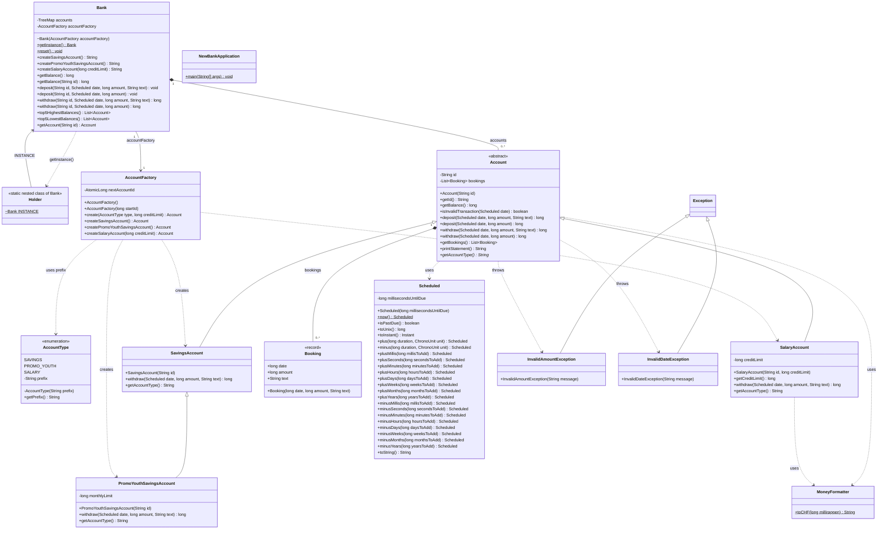

# Klassendiagramm

Stand nach Sprint 5. Alle Klassen aus `src/main/java/ch/bbw` mit Attributen, Methoden und
Beziehungen. Beträge sind immer `long` in Millirappen (`100_000` = CHF 1.00).

## Legende

| Zeichen | Bedeutung |
|---|---|
| `+` / `-` / `~` | public / private / package-private |
| `$` | static |
| `*` nach einer Methode | abstrakt, jede Unterklasse muss sie umsetzen |
| Pfeil mit leerem Dreieck | Vererbung (`extends`) |
| Raute | Komposition: die Bank hält ihre Konten, ein Konto hält seine Buchungen |
| durchgezogener Pfeil | Assoziation: die Bank kennt ihre `AccountFactory` |
| gestrichelter Pfeil | Abhängigkeit: verwendet, erzeugt oder wirft |

## Was das Diagramm zeigt

- **Vererbung:** `Account` ist abstrakt. `SavingsAccount` verbietet das Überziehen,
  `PromoYouthSavingsAccount` ist ein Sparkonto mit zusätzlicher Monatslimite von CHF 200, und
  `SalaryAccount` darf bis zur Kreditlimite überzogen werden. Jeder Typ setzt `getAccountType()` um.
- **Factory:** Nur die `AccountFactory` erzeugt konkrete Konten. Die `Bank` kennt nur `Account`
  und importiert keine konkrete Kontoklasse.
- **Singleton:** Die einzige `Bank` liegt in der inneren Klasse `Holder` und kommt über
  `Bank.getInstance()`. Der Konstruktor ist package-private und bekommt die `AccountFactory`
  übergeben.
- **Saldo:** Es gibt kein Attribut `balance`; `getBalance()` ist die Summe aller Buchungen.
- **Konten der Bank:** `accounts` ist eine `TreeMap<String, Account>` mit der Kontonummer als
  Schlüssel (Mermaid kann Generics mit Komma nicht darstellen).
