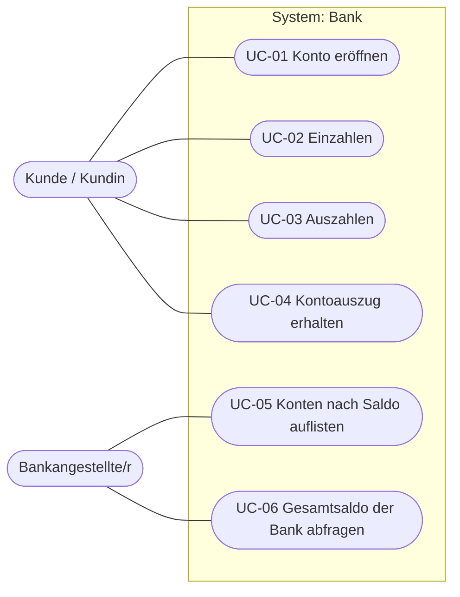

# Anwendungsfälle

Pro Anwendungsfall gibt es eine eigene Beschreibung `UC-XX-….md` mit allen Pflichtfeldern
(Name, Kurzbeschreibung, Akteure, Auslöser, Ergebnisse, Vorbedingung, Nachbedingung, eingehende
Daten, essenzieller Ablauf, offene Punkte, Änderungshistorie, Sonstiges, Anmerkungen).

## Anwendungsfalldiagramm

| Nr. | Anwendungsfall | Akteur | Sprint | Beschreibung |
|---|---|---|---|---|
| UC-01 | Konto eröffnen | Kunde | 1, 3, 4 | [UC-01-konto-eroeffnen.md](UC-01-konto-eroeffnen.md) |
| UC-02 | Einzahlen | Kunde | 1, 2 | [UC-02-einzahlen.md](UC-02-einzahlen.md) |
| UC-03 | Auszahlen | Kunde | 1, 2, 3 | [UC-03-auszahlen.md](UC-03-auszahlen.md) |
| UC-04 | Kontoauszug erhalten | Kunde | 2 | [UC-04-kontoauszug-erhalten.md](UC-04-kontoauszug-erhalten.md) |
| UC-05 | Konten nach Saldo auflisten | Bankangestellte/r | extra | [UC-05-konten-nach-saldo-auflisten.md](UC-05-konten-nach-saldo-auflisten.md) |
| UC-06 | Gesamtsaldo der Bank abfragen | Bankangestellte/r | 1 | [UC-06-gesamtsaldo-abfragen.md](UC-06-gesamtsaldo-abfragen.md) |

Die Klassen hinter den Anwendungsfällen zeigt das [Klassendiagramm](../class-diagram.md), den
Aufbau und die Entscheide die [Architektur](../architecture.md).
